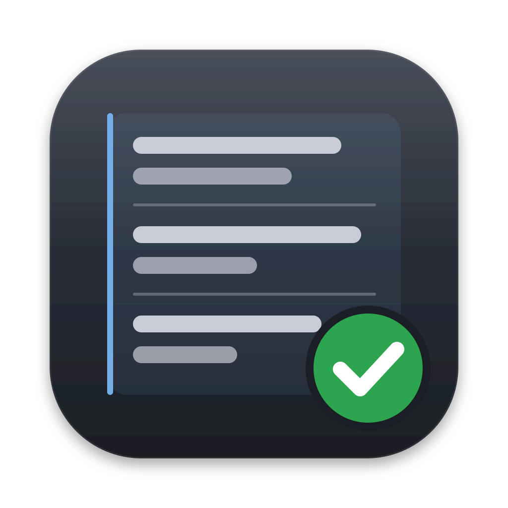
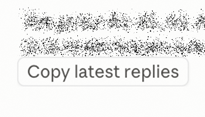
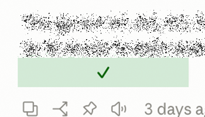

<p align="center">
  
</p>

<h1 align="center">Copy latest replies</h1>

<p align="center">
  <strong>One button to copy everything Claude said since your last message.</strong><br>
  A Claude Code mod for the terminal and the Desktop app · MIT
</p>

<p align="center">
  
  
</p>

## Why

Claude Code now splits a long piece of work into several reply blocks. Each time a subagent sends the session a message, a new block starts, with its own copy button. After a few hours of autonomous work, what Claude told you since your last message can be spread over twenty blocks.

Reading all of it matters. We review less and less of the code an agent writes, but the agent's report is where the decisions are: what it chose, what it skipped, what it needs from you. Copying it block by block is slow and easy to get wrong.

This mod adds one button under Claude's last reply. It copies everything Claude wrote since the last message you sent, in order, ready to paste into your notes, a review tool such as [SpeedRead](https://github.com/TomySpagnoletti/speed-reading-app), or another model.

## What it copies

Everything Claude shows you since the last message you sent from the prompt box:

- the text of every reply block, in order;
- the thinking Claude shows, when the transcript keeps it;
- the questions Claude asked you, with the answer you gave.

What it leaves out: your messages, tool calls and their output.

Reply blocks are separated by a markdown rule, exactly where the app shows a new copy button. Questions are set apart the same way:

```text
Placeholders added and translators told. Now the open choices.

---

Q: [PostgreSQL] Move the containers to the PostgreSQL 18 client?
A: Client 18 (Recommended)

---

Noted: PostgreSQL 18 client. Starting the migration.

---

The second reviewer found one blocking issue in the harness…
```

Once the button is pressed, a green check replaces its label for a moment. The command `/copy-latest-replies` does the same from the prompt.

## Install

In a Claude Code session:

```text
/plugin install copy-latest-replies --marketplace TomySpagnoletti/cc-mods-copy-latest-replies
```

Or from your shell:

```bash
claude plugin marketplace add TomySpagnoletti/cc-mods-copy-latest-replies
claude plugin install copy-latest-replies@cc-mods-copy-latest-replies
```

Then start a new session, or run `/reload-plugins`.

**Requirements:** Claude Code v2.1.287 or later in the terminal, or a Desktop app whose Code tab reports v2.1.286 or later in `/status`. Claude Code mods are an early-access feature, so a future release may change what they can do.

## How it works

The mod reads the session's transcript, the JSONL file Claude Code keeps on your disk, rather than what the session holds in memory. That way it still finds everything after a compaction.

- **Where it stops.** The engine marks a prompt sent from the prompt box with the origin `{"kind": "human"}`, and nothing else carries it: not task notifications, not messages from subagents, not compaction summaries, not your answers to Claude's questions. The mod copies everything after the last row with that mark.
- **Which conversation.** It follows each row's parent from the newest one, so a branch you rewound is left out, and it crosses a compaction through its logical parent.
- **Where blocks split.** Any incoming message opens a new reply block, except a task notification, which the app shows inside the current block. Checked against twenty native copy buttons on a real session: the same 359 paragraphs, in the same order.
- **Large transcripts.** A transcript can weigh tens of megabytes. The mod finds the last prompt with `grep` and reads from there in chunks.

## Privacy and permissions

Everything stays on your machine. The mod makes no network request, and the only place it sends anything is your clipboard.

**What it reads.** Your session's transcript, which holds the conversation, and the session's messages, to know which reply is the last one. To locate the transcript it reads two environment variables, `CLAUDE_CONFIG_DIR` and `HOME`.

**What it sends, and where.** The copied text, to your clipboard, and only when you press the button or run `/copy-latest-replies`. It goes through Claude Code's own copy call. When that call fails on the terminal or the Desktop app, the mod hands the same text to your system's clipboard tool on its standard input.

**Which programs it runs, and why.** Each program name is fixed in the code. The arguments are the transcript's path, the session id and line numbers.

| Program | Command | Why |
| --- | --- | --- |
| `find` | `find <config dir>/projects -maxdepth 2 -name <session id>.jsonl` | Locate the transcript, when no hook event has named it yet |
| `grep` | `grep -n -o -F '"origin":{"kind":"human"}' <transcript>` | Find the lines of the prompts you sent |
| `wc` | `wc -l <transcript>` | Count the transcript's lines |
| `sed` | `sed -n '<first>,<last>p' <transcript>` | Read the transcript from your last prompt on, in chunks |
| `pbcopy`, `powershell`, `wl-copy`, `xclip` | `pbcopy` · `powershell -NoProfile -Command "Set-Clipboard -Value ([Console]::In.ReadToEnd())"` · `wl-copy` · `xclip -selection clipboard` | Clipboard fallback on macOS, Windows, Wayland and X11, tried in that order, only when Claude Code's copy call fails |

**Which events it hooks.** None of them change what passes through.

| Event | What the mod does |
| --- | --- |
| `session.start` | Registers the `/copy-latest-replies` command |
| `classic.SessionStart`, `classic.UserPromptSubmit` | Keeps the transcript path the event carries, and passes the event on unchanged |
| `turn.start`, `turn.complete` | Hides the button while Claude works on a turn of the main conversation, and shows it again when the turn ends |
| `command.run`, for `/copy-latest-replies` only | Copies the replies and answers `✓ Copied` or `✗ Nothing copied` |
| `ui.render`, for `AssistantMessage` | Draws the button under Claude's last reply, and leaves the reply itself as it is |

You can check all of this before installing: `claude plugin validate` on a clone of this repository prints every event the mod hooks and every call it makes.

## Limits

- The button shows in the terminal and in the Desktop app's Code tab. Remote surfaces, such as Remote Control from claude.ai or the mobile app, draw what a mod adds only partly, if at all.
- Over Remote Control, the session runs on your computer, so the mod has to be installed there.
- It copies Markdown as Claude wrote it, not the rendered text.

## Development

```bash
claude plugin validate --strict .
claude plugin test .
```

To try a change, start Claude Code with `claude --plugin-dir .` from a clone.

## License

MIT © 2026 Tomy Spagnoletti Duval
